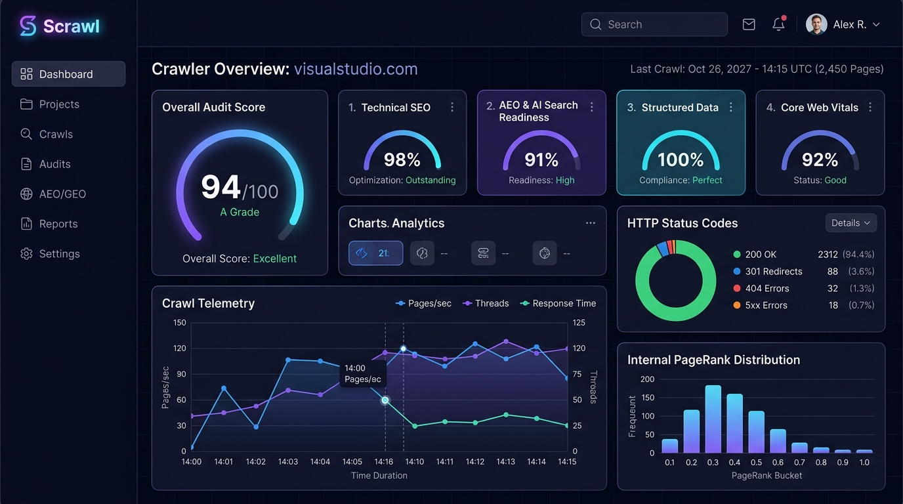
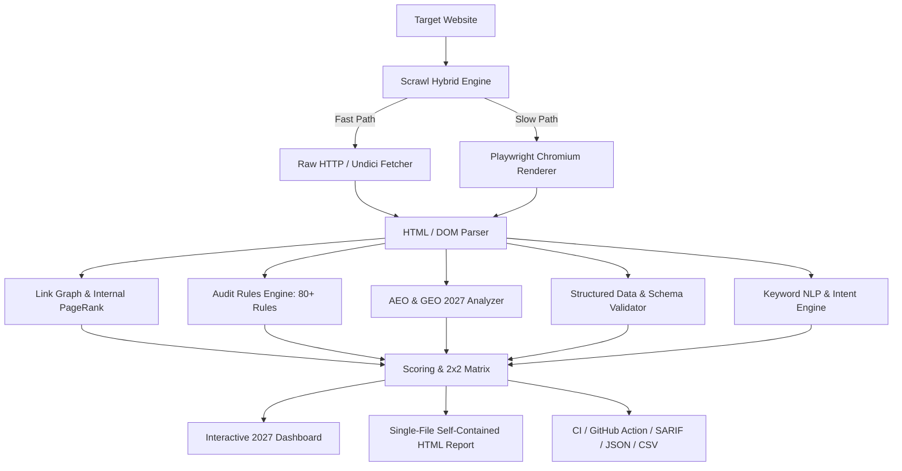
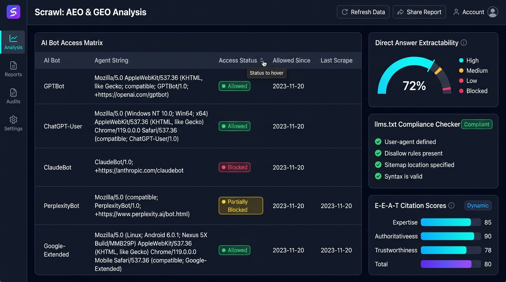
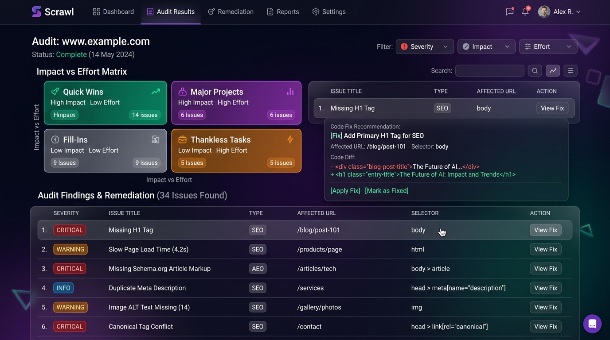

# ⚡ Scrawl (`scrawl-technical-seo-aeo-crawler`)

<div align="center">

```
   _____                           _ 
  / ____|                         | |
 | (___   ___ _ __ __ ___      ___| |
  \___ \ / __| '__/ _` \ \ /\ / / | |
  ____) | (__| | | (_| |\ V  V /| | |
 |_____/ \___|_|  \__,_| \_/\_/ |_|_|
```

### The Autonomous Website Auditor Built for the 2027 AI Search Era
**Technical SEO • On-Page Intelligence • AEO (Answer Engine Optimization) • GEO (Generative Engine Optimization) • Core Web Vitals • Internal PageRank**

[](https://opensource.org/licenses/MIT)
[](https://www.typescriptlang.org/)
[](https://nodejs.org/)
[](https://turbo.build/)
[](https://github.com/imranbru99/scrawl-technical-seo-aeo-crawler)
[](https://github.com/imranbru99/scrawl-technical-seo-aeo-crawler/blob/main/CONTRIBUTING.md)

[Screenshots](#-application-screenshots) • [Features](#-key-features) • [Installation](#-installation--setup) • [Architecture](#-monorepo-architecture) • [AEO & GEO Deep Dive](#-aeo--geo-engine-2027-ai-search-readiness) • [Audit Catalog](#-audit-rule-catalog) • [CLI Reference](#-cli-command-reference)

<br/>



</div>

---

## 🚀 Overview

**Scrawl** is a high-performance, open-source technical SEO and AI search auditor engineered from scratch to answer the fundamental shift in web discovery: **from traditional 10 blue links to Generative Search Engines (Google AI Overviews, ChatGPT Search, Perplexity, Claude, Gemini, Copilot, Apple Intelligence).**

While legacy crawlers stop at basic status codes and meta tags, Scrawl combines:
1. **Raw HTTP + Headless Chromium Hybrid Engine:** Blazing fast network-level crawls with selective JS hydration and raw-vs-rendered DOM diffing.
2. **Deep Technical & Architecture Auditing:** Redirect loops, canonical conflicts, hreflang reciprocity, internal PageRank calculation, crawl traps, and orphan page detection.
3. **The 2027 AEO/GEO Readiness Engine:** Evaluates your site for answer extractability, 23+ AI bot access policies, `llms.txt` validation & generation, E-E-A-T credentials, passage chunking, and factual citation worthiness.
4. **Deterministic Heuristic Scoring:** 0–100 category grades with clear, mathematical point-loss formulas and an actionable $2 \times 2$ Impact vs Effort prioritization matrix.
5. **Zero-Mock, Real Evidence Guarantee:** Every single finding contains the exact URL, CSS selector, value found, expected value, code fix example, and step-by-step remediation guide.

---

## 💎 Key Features



### 1. 🌐 Next-Gen Crawling Core
- **Hybrid Fetching:** Dual-mode pipeline using `undici` connection pooling for ultra-low latency, switching automatically to Playwright Chromium when JavaScript-rendered frameworks (React, Next.js, Vue, Nuxt, Angular, Svelte) are detected.
- **Raw-vs-Rendered DOM Diffing:** Instantly exposes content, links, canonicals, or meta robots injected or altered exclusively by client-side JavaScript.
- **Enterprise Politeness & Scale:** Strict per-host rate limiting, `robots.txt` longest-match evaluation, exponential backoff on 429/503, streaming disk persistence, and tested up to 100,000+ pages under 1 GB RAM.
- **Internal PageRank & Link Graph:** Iterative PageRank calculated across all internal edges; identifies orphan pages, dead ends, click depth distribution, and high-equity link funnels.
- **Hardened Security & SSRF Defense:** Strict DNS-rebinding guard and private/loopback/cloud metadata IP filter (`169.254.169.254`, `10.0.0.0/8`, `127.0.0.0/8`, etc.).

### 2. 🤖 2027 AEO & GEO (AI Search Engine Optimization)
- **23+ AI Crawler Registry:** Live access matrix for GPTBot, ChatGPT-User, OAI-SearchBot, ClaudeBot, Claude-Web, PerplexityBot, Google-Extended, GoogleOther, Applebot-Extended, Amazonbot, CCBot, Meta-ExternalAgent, and ByteSpider.
- **Training vs Retrieval Segmentation:** Configure distinct policies for allowing real-time AI citation while blocking unauthorized LLM training.
- **`llms.txt` & `llms-full.txt` Suite:** Validates existing markdown context files and automatically **synthesizes a production-ready `llms.txt`** from top internal PageRank clusters.
- **Passage Extractability & Answer-First Analysis:** Scans headings and opening paragraphs for 40–60 word direct answers, inverted pyramid formatting, question density, definition syntax, and self-contained paragraph units.
- **E-E-A-T & Citation Strength:** Scores author bylines, reviewer credentials, outbound authority links, data tables, exact numeric claims, and verified schema entities.

### 3. 🏷️ Schema.org & Google Rich Results
- **Full Parse & Extraction:** Supports JSON-LD, Microdata, and RDFa with deep entity graph linking (`@id` and `@graph`).
- **Google Rich Result Eligibility:** Strict validation against required and recommended properties for Article, Product, Organization, LocalBusiness, FAQPage, HowTo, BreadcrumbList, VideoObject, Recipe, Course, and JobPosting.
- **Missing Schema Generator:** Automatically detects un-annotated FAQs, products, or how-to sections and generates **ready-to-paste JSON-LD snippets**.

### 4. 🎯 Keyword Intelligence & Cannibalization
- **Local Heuristic NLP (Zero API Key Needed):** TF-IDF corpus scoring, n-gram extraction (1-word, 2-word, 3-word), RAKE/YAKE keyphrase identification, and readability indices (Flesch, Fog, Coleman-Liau, SMOG).
- **Cannibalization Detection:** Flags competing internal URLs sharing identical high-frequency keyphrases, headings, and semantic intent.
- **Topic Clustering:** Automatically groups URLs into topic clusters with designated pillar pages and suggested internal anchor text opportunities.

### 5. 📊 2027 Futuristic Dashboard & Single-File HTML Reports
- **Cyberpunk / Glassmorphic UI:** Deep indigo dark mode, glowing neon telemetry, smooth spring animations, and responsive micro-interactions.
- **Offline Single-File HTML Report:** Zero external CDN dependencies, self-contained SVG icons, interactive filters, dark/light toggle, and print-optimized PDF layout.
- **Live SSE Crawl Telemetry:** Stream queue rate, throughput (pages/sec), HTTP status counts, and error streams in real time.

---

## 📸 Application Screenshots

### 1. Unified Auditor & Live Crawl Telemetry Dashboard
> Real-time crawl progress, HTTP status distribution, Core Web Vitals, and internal PageRank flow in a sleek cyberpunk dark mode interface.

<div align="center">
  
</div>

<br/>

### 2. 2027 AEO & GEO AI Search Readiness & Bot Access Matrix
> Live access policies for 23+ AI search retrieval bots (ChatGPT, Perplexity, Claude, Gemini, Apple Intelligence), direct answer extractability scoring, and `llms.txt` validation.

<div align="center">
  
</div>

<br/>

### 3. Actionable Remediation & Impact vs Effort $2 \times 2$ Matrix
> Deterministic quadrant prioritization (Quick Wins vs Major Projects) coupled with zero-mock code diff recommendations and exact DOM selector targeting.

<div align="center">
  
</div>

---

## 📦 Installation & Setup

### 📋 Prerequisites
Ensure you have the following installed on your machine:
- **Node.js**: `v20.0.0` or higher ([Download](https://nodejs.org/))
- **pnpm**: `v9.0.0` or higher (`npm install -g pnpm`)
- **Git**

---

### 🚀 Step-by-Step Installation

#### 1. Clone the Repository
```bash
git clone https://github.com/imranbru99/scrawl-technical-seo-aeo-crawler.git
cd scrawl-technical-seo-aeo-crawler
```

#### 2. Install Dependencies
```bash
pnpm install
```

#### 3. Install Playwright Headless Chromium (Optional, for JavaScript rendering)
If you plan to audit client-side rendered sites (React, Next.js, Vue, Nuxt, Angular, Svelte):
```bash
pnpm exec playwright install chromium
```

#### 4. Build Monorepo Packages
Compile all TypeScript packages (`shared`, `config`, `storage`, `core`):
```bash
pnpm build
```

#### 5. Run Test Suite
Verify that all tests and deterministic heuristic fixtures pass:
```bash
pnpm test
```

---

### ⚡ Quick Start Options

#### Option A: Zero-Install Instant Audit (via npx)
Run Scrawl directly on any public site without cloning:
```bash
npx scrawl-seo audit https://example.com
```

#### Option B: Global CLI Installation
```bash
npm install -g scrawl-seo
# or
pnpm add -g scrawl-seo
```

---

## 💻 CLI Command Reference

Scrawl features an intuitive, unified CLI powered by `commander`:

| Command | Description | Example |
|---|---|---|
| `scrawl audit <url>` | Full crawl + rule audit + scoring + multi-format report | `scrawl audit https://example.com --render auto --depth 5` |
| `scrawl crawl <url>` | Crawl website only and store raw snapshot in SQLite | `scrawl crawl https://example.com --max-pages 500` |
| `scrawl aeo <url>` | Instant single-page AEO & GEO readiness check | `scrawl aeo https://example.com/blog/guide` |
| `scrawl robots <url>` | Analyze `robots.txt` and generate AI-bot access matrix | `scrawl robots https://example.com` |
| `scrawl llms <url>` | Validate or generate `llms.txt` from site content | `scrawl llms https://example.com --generate` |
| `scrawl schema <url>` | Extract and validate JSON-LD structured data | `scrawl schema https://example.com/product/123` |
| `scrawl compare <idA> <idB>` | Regression diff between two previous crawls | `scrawl compare crawl_101 crawl_102` |
| `scrawl serve` | Launch the Fastify API server and 2027 Dashboard | `scrawl serve --port 3000` |
| `scrawl doctor` | Validate system Chromium, network, and environment | `scrawl doctor` |

### Key Flags for `scrawl audit`:
- `--render <auto|always|never>`: JavaScript execution mode (default: `auto`).
- `--max-pages <n>`: Maximum number of pages to crawl (default: `100`).
- `--depth <n>`: Maximum crawl click depth from start URL (default: `5`).
- `--concurrency <n>`: Concurrent fetch workers (default: `5`).
- `--delay <ms>`: Delay between requests per host (default: `200`).
- `--format <html,json,csv,md,sarif>`: Output formats (default: `html,json`).
- `--user-agent <preset>`: Presets: `scrawl`, `googlebot-desktop`, `googlebot-smartphone`, `gptbot`, `claudebot`, `perplexitybot`.
- `--fail-under <score>`: CI threshold; exits with code `1` if overall score is below threshold.
- `--fail-on <severity>`: CI threshold; fails if any issue with given severity (e.g. `critical`) is detected.
- `--ci`: Streamlined non-interactive output tailored for GitHub Actions / GitLab CI.

---

## ⚙️ Configuration (`scrawl.config.ts`)

Create a type-safe `scrawl.config.ts` in your project root:

```typescript
import { defineConfig } from '@scrawl/config';

export default defineConfig({
  startUrls: ['https://example.com'],
  maxPages: 250,
  maxDepth: 4,
  concurrency: 8,
  renderMode: 'auto',
  respectRobotsTxt: true,
  allowSubdomains: false,
  
  // Custom headers & cookies
  headers: {
    'X-Custom-Header': 'Audit-Bot',
  },

  // 2027 AI & AEO Targeting
  brandTerms: ['Acme', 'Acme Cloud'],
  keywords: [
    { keyword: 'enterprise cloud crawler', url: 'https://example.com/enterprise', intent: 'commercial', priority: 'high' },
    { keyword: 'what is aeo', url: 'https://example.com/blog/aeo-guide', intent: 'informational', priority: 'high' },
  ],

  // CI Quality Gates
  ci: {
    failUnderScore: 85,
    failOnSeverity: 'critical',
    alertRegressionPoints: 5,
  },

  // Custom Category Weights (Must sum to 100)
  weights: {
    technical: 25,
    onpage: 15,
    aeo: 20,
    performance: 12,
    content: 10,
    'structured-data': 8,
    security: 6,
    international: 2,
    accessibility: 2,
  },

  // Output formatting
  reporters: {
    formats: ['html', 'json', 'markdown', 'sarif'],
    outDir: './scrawl-report',
    brandName: 'Acme SEO Command',
    brandColor: '#6366f1',
  },
});
```

---

## 🧠 AEO & GEO Engine: 2027 AI Search Readiness

Search in 2027 is fundamentally agentic and synthetic. AI synthesizers do not rank URLs; they extract, verify, and cite atomic knowledge chunks. Scrawl evaluates your site against the 6 core pillars of Generative Engine Optimization:

```
┌────────────────────────────────────────────────────────────────────────┐
│                        AEO READINESS SCORING                           │
├─────────────────────────┬──────────────────────────────────────────────┤
│ 1. AI Crawlability      │ Unblocked access for 23+ retrieval bots      │
│ 2. Direct Answer Format │ Direct answer within 40-60 words of H2/H3    │
│ 3. Passage Chunking     │ 100-300 token self-contained text blocks     │
│ 4. Entity Density       │ Schema @id graph + sameAs authoritative links│
│ 5. Citation Worthiness  │ Numerical data, original statistics, sources │
│ 6. llms.txt Compliance  │ Concise, structured LLM-readable summary     │
└────────────────────────────────────────────────────────────────────────┘
```

### The 23+ AI Crawler Matrix

Scrawl audits your `robots.txt` and web server against both **LLM Training Crawlers** and **Live Retrieval Agents**:

| Bot ID | Operator | Default Purpose | Recommended Stance |
|---|---|---|---|
| `gptbot` | OpenAI | Model Training | Disallow (if protecting IP) |
| `chatgpt-user` | OpenAI | Live User Fetch | **Allow** (Required for ChatGPT citations) |
| `oai-searchbot` | OpenAI | Search Indexing | **Allow** (Required for OpenAI Search) |
| `claudebot` | Anthropic | Model Training | Disallow (optional) |
| `claude-web` | Anthropic | Live Retrieval | **Allow** (Required for Claude citations) |
| `perplexitybot` | Perplexity AI | Search Indexing | **Allow** (Critical for Perplexity rankings) |
| `google-extended`| Google | Gemini Training | Disallow (optional, doesn't impact Google Search) |
| `googleother` | Google | General AI R&D | **Allow** |
| `applebot-extended`| Apple | Apple Intelligence Training | Disallow (optional) |
| `cohere-ai` | Cohere | Enterprise Training | Disallow / Allow |
| `meta-externalagent`| Meta | Llama Training | Disallow / Allow |

---

## 📋 Audit Rule Catalog

Every rule is a modular plugin providing mathematical impact ratings, estimated remediation effort, documentation link, and positive/negative test fixtures:

### 1. Technical SEO & Indexability (`TECH-*`)
- `TECH-ROBOTS-001`: Valid `robots.txt` syntax, size < 500 KiB, and protocol matching.
- `TECH-ROBOTS-002`: Sitemaps declared within `robots.txt`.
- `TECH-ROBOTS-003`: Accidental site-wide disallow (`Disallow: /`) guard.
- `TECH-ROBOTS-004`: CSS/JS/image rendering assets blocked by robots.txt.
- `TECH-CANON-001`: Missing canonical URL tag.
- `TECH-CANON-002`: Multiple conflicting canonical tags in DOM or HTTP headers.
- `TECH-CANON-003`: Canonical tag pointing to 404, 301, 302 or non-indexable target.
- `TECH-CANON-004`: Canonical chain or self-referential canonical mismatch.
- `TECH-SITEMAP-001`: XML sitemap discovery, XML validity, and size sanity (< 50,000 URLs).
- `TECH-SITEMAP-002`: Non-200 or noindex URLs mistakenly listed in XML sitemaps.
- `TECH-STATUS-001`: Broken internal links (4xx client error, 5xx server error).
- `TECH-STATUS-002`: Soft 404 detection (HTTP 200 containing "Page Not Found" thin DOM).
- `TECH-REDIR-001`: Redirect chains (> 1 hop) and circular redirect loops.
- `TECH-REDIR-002`: Internal links pointing to redirected targets.
- `TECH-ORPHAN-001`: Orphan pages detected (present in sitemap but zero inlinks in link graph).
- `TECH-DEPTH-001`: Click depth exceeds 4 clicks from root URL.
- `TECH-JS-001`: Critical content visible exclusively after JavaScript execution.
- `TECH-JS-002`: Internal links discovered only after JavaScript rendering.
- `TECH-HREFLANG-001`: Missing bidirectional return tags (hreflang reciprocity).
- `TECH-HREFLANG-002`: Invalid ISO 639-1 language or ISO 3166-1 country codes.

### 2. On-Page & Content Quality (`PAGE-*`)
- `PAGE-TITLE-001`: Title tag missing, empty, or duplicate across multiple pages.
- `PAGE-TITLE-002`: Title length exceeds 60 characters / 580 pixels (SERP truncation risk).
- `PAGE-TITLE-003`: Title too short (< 30 characters) or missing primary keyword.
- `PAGE-META-001`: Meta description missing or duplicate.
- `PAGE-META-002`: Meta description length outside optimal window (70–160 characters).
- `PAGE-H1-001`: Missing or empty `<h1>` heading.
- `PAGE-H1-002`: Multiple `<h1>` headings found on standard article/product page.
- `PAGE-HEADING-001`: Skipped heading hierarchy levels (e.g. `<h1>` immediately to `<h3>`).
- `PAGE-CONTENT-001`: Thin content warning (< 300 words).
- `PAGE-CONTENT-002`: Near-duplicate content detected via 64-bit SimHash ($\text{similarity} > 90\%$).
- `PAGE-READ-001`: Flesch Reading Ease score below target readability threshold.
- `PAGE-IMG-001`: Images missing descriptive `alt` attributes.
- `PAGE-IMG-002`: Images missing explicit `width` and `height` (CLS shift risk).
- `PAGE-LINK-001`: Vague anchor text ("click here", "read more", "link").
- `PAGE-LINK-002`: External link with `target="_blank"` missing `rel="noopener"`.

### 3. AEO & GEO Readiness (`AEO-*`)
- `AEO-BOTS-001`: Crucial AI search retrieval bots blocked in `robots.txt` (`chatgpt-user`, `perplexitybot`, etc.).
- `AEO-LLMS-001`: Missing or malformed `llms.txt` summary file.
- `AEO-ANSWER-001`: Missing direct answer block (40–60 words) under question-based headings.
- `AEO-CHUNK-001`: Long monolithic content lacking modular, self-contained sub-passages.
- `AEO-EEAT-001`: Missing author byline, author bio, or credential references.
- `AEO-CIT-001`: Unsubstantiated claims lacking outbound citations or quantitative metrics.
- `AEO-JS-001`: Main content rendered only via JavaScript (AI retrieval crawlers skip JS execution).

### 4. Structured Data & Schema (`SCHEMA-*`)
- `SCHEMA-VALID-001`: JSON-LD syntax errors or invalid schema.org types.
- `SCHEMA-RICH-001`: Missing Google required properties for eligible Rich Results.
- `SCHEMA-OPP-001`: High-confidence schema opportunity detected without markup (FAQ, Product, Recipe).

### 5. Security & Server Headers (`SEC-*`)
- `SEC-HTTPS-001`: Insecure HTTP endpoints or active mixed-content assets.
- `SEC-HSTS-001`: Missing or misconfigured HSTS header (minimum 1 year max-age).
- `SEC-HDR-001`: Missing security headers (`Content-Security-Policy`, `X-Content-Type-Options`).
- `SEC-EXPOSE-001`: Sensitive files exposed (`.git`, `.env`, `wp-config.php`, backup archives).

---

## 🧮 Deterministic Scoring Engine

Scrawl calculates scores deterministically from 0 to 100 with zero black-box magic:

$$\text{Category Score} = \max\left(0, 100 - \sum \left(\text{Penalty} \times \text{Prevalence Curve} \times \text{Confidence}\right)\right)$$

$$\text{Overall Score} = \sum_{c} \left(\text{Category Score}_c \times \frac{\text{Weight}_c}{100}\right)$$

### Letter Grades
- 🏆 **A+** : $97 - 100$
- 🥇 **A**  : $90 - 96$
- 🥈 **B**  : $80 - 89$
- 🥉 **C**  : $70 - 79$
- ⚠️ **D**  : $55 - 69$
- ❌ **F**  : $< 55$

### The $2 \times 2$ Action Matrix
Every finding is scored on a priority scale:

$$\text{Priority Score} = \frac{\text{Impact} \times \text{Affected URLs Weight} \times \text{PageRank Weight}}{\text{Effort}}$$

This classifies all remediation items into 4 distinct quadrants:
1. 🚀 **Quick Wins:** High impact, trivial/easy effort (Fix immediately).
2. 🎯 **Major Projects:** High impact, moderate/hard effort (Sprint backlog).
3. 🧹 **Fill-Ins:** Low impact, easy effort (Code hygiene).
4. ⏳ **Thankless Tasks:** Low impact, high effort (Lowest priority).

---

## 🧪 CI / CD Integration & GitHub Actions

Automate technical SEO & AEO testing on every pull request.

```yaml
# .github/workflows/scrawl.yml
name: Scrawl Technical SEO & AEO Audit

on:
  pull_request:
    branches: [main]
  schedule:
    - cron: '0 3 * * 1' # Every Monday at 3 AM

jobs:
  audit:
    runs-on: ubuntu-latest
    steps:
      - uses: actions/checkout@v4

      - name: Run Scrawl Audit
        uses: scrawl-seo/scrawl-action@v1
        with:
          url: 'https://staging.example.com'
          fail-under: 85
          fail-on: 'critical'
          formats: 'html,json,sarif'
          output-dir: './reports'

      - name: Upload SARIF to GitHub Code Scanning
        uses: github/codeql-action/upload-sarif@v3
        if: always()
        with:
          sarif_file: './reports/scrawl.sarif'

      - name: Upload HTML Audit Report
        uses: actions/upload-artifact@v4
        with:
          name: scrawl-audit-report
          path: './reports/scrawl-report.html'
```

---

## ⚖️ Comparison Matrix

| Capability | Scrawl | Screaming Frog | Sitebulb | Lighthouse | Ahrefs / Semrush |
|---|:---:|:---:|:---:|:---:|:---:|
| **License** | **Open Source (MIT)** | Commercial | Commercial | Open Source (Apache) | Commercial SaaS |
| **AEO / GEO Engine** | **Native Deep Analysis** | ❌ None | ❌ None | ❌ None | ❌ None |
| **23+ AI Bot Matrix** | **Built-in & Live** | Manual regex | ❌ None | ❌ None | Partial |
| **`llms.txt` Generator** | **Automated** | ❌ None | ❌ None | ❌ None | ❌ None |
| **Direct Answer Scorer**| **Yes (NLP)** | ❌ None | ❌ None | ❌ None | ❌ None |
| **Headless JS Rendering**| **Playwright Chromium**| Chromium | Chromium | Headless Chrome | Cloud Renderers |
| **Raw vs JS DOM Diff** | **Instant Side-by-Side**| Diff Tab | Hints | ❌ None | ❌ None |
| **Internal PageRank** | **Iterative Matrix** | Calculated | Flow Metric | ❌ None | Proprietary |
| **Single-File HTML Report**| **Zero CDN, Interactive**| ❌ Export only | ❌ Export only | Single HTML | ❌ Cloud only |
| **CI / CD SARIF Output**| **Native** | ❌ None | ❌ None | ❌ None | ❌ None |
| **Zero Mock Guarantee** | **Strict (No Fake APIs)**| Yes | Yes | Yes | Modeled estimates |

---

## 📦 Monorepo Architecture

```
scrawl-technical-seo-aeo-crawler/
├─ apps/
│  ├─ cli/                 # `scrawl` command executable (Commander + Chalk + Ora)
│  ├─ api/                 # Fastify REST + OpenAPI + Server-Sent Events (SSE)
│  └─ dashboard/           # Next.js 15 App Router + Cyberpunk 2027 Design System
├─ packages/
│  ├─ core/                # Crawler core (Undici, Playwright, Queue, Link Graph, PageRank)
│  ├─ rules/               # 80+ Modular audit rules (auto-registered plugins)
│  ├─ scoring/             # Deterministic scoring engine, weights, 2x2 matrix
│  ├─ aeo/                 # AEO/GEO engine, 23 AI bot access matrix, llms.txt builder
│  ├─ keywords/            # TF-IDF, intent classifier, cannibalization, topic clusters
│  ├─ structured-data/     # JSON-LD/Microdata parser, Google rich result validator
│  ├─ performance/         # Lighthouse, Core Web Vitals, CrUX field data adapters
│  ├─ reporters/           # HTML self-contained, JSON, CSV, Markdown, SARIF, JUnit
│  ├─ storage/             # SQLite WAL database + 31 Drizzle schema tables
│  ├─ config/              # Zod config schema + loader + env var interpolation
│  └─ shared/              # Domain types, SimHash, SSRF defense, Logger, text formulas
├─ fixtures/               # Test sites: perfect-score, hostile-site, js-only, redirect-loop
└─ docs/                   # Full documentation & rule specifications
```

---

## 🔒 Security, Privacy & Crawling Ethics

1. **Permission First:** Only crawl domains you own or have explicit authorization to audit.
2. **Robots.txt Adherence:** Scrawl honors `robots.txt` and `Crawl-delay` directives by default.
3. **Local-First & Zero Leakage:** Your crawled data, cookies, and tokens stay on your local disk. No audit telemetry is sent to any third party.
4. **Hardened SSRF Guard:** Network requests targeting `localhost`, `127.0.0.1`, RFC 1918 subnets, or cloud metadata instances (`169.254.169.254`) are blocked by default.

---

## 🤝 Contributing

We welcome contributions from SEO specialists, distributed systems engineers, and AI researchers!
Check out [CONTRIBUTING.md](CONTRIBUTING.md) to get started. Add a new audit rule in under 10 minutes with our modular plugin system.

```bash
# Add a new rule
pnpm new:rule
```

---

## 📜 License

Distributed under the **MIT License**. See [LICENSE](LICENSE) for more information.

<div align="center">
<sub>Crafted with passion for the future of search by the Scrawl Open Source Community.</sub>
</div>
